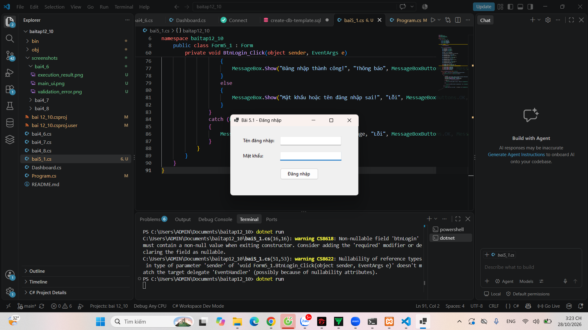
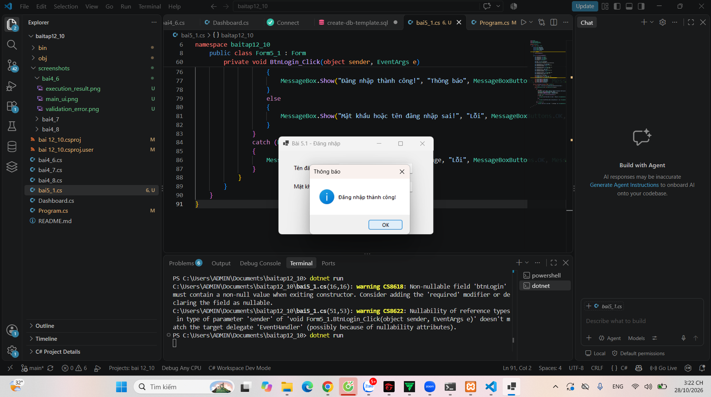
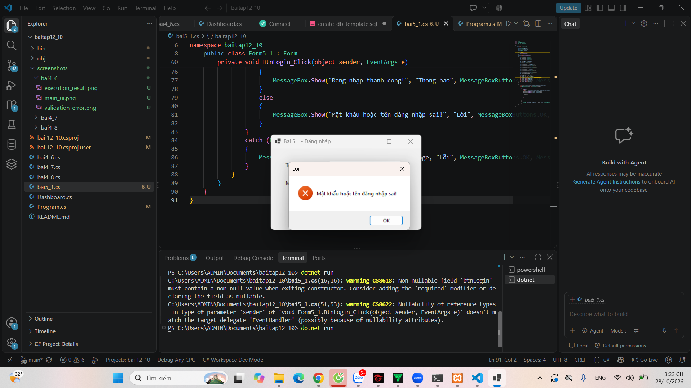
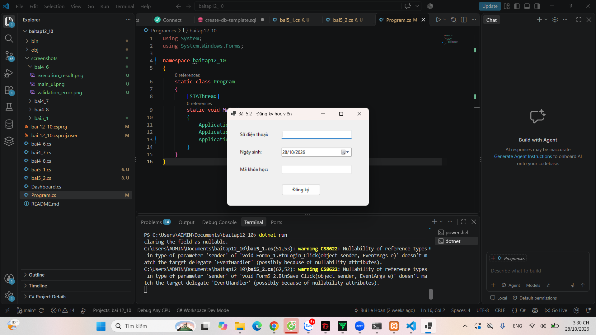
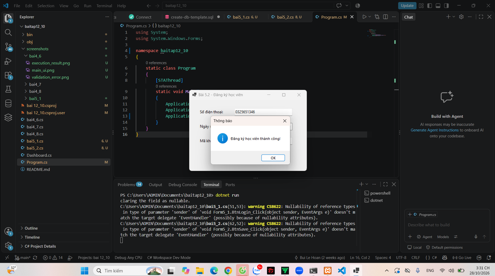
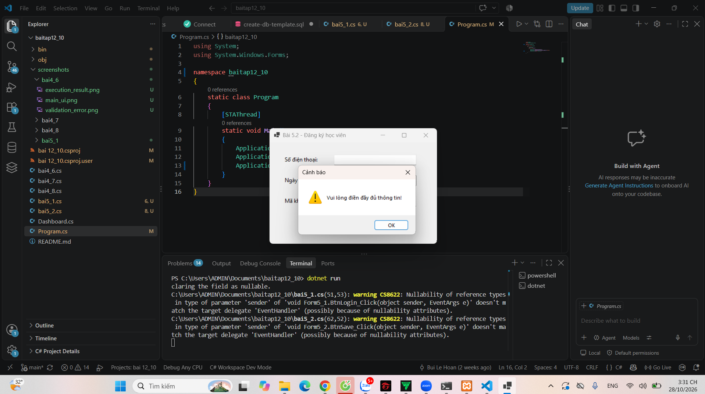

# BÁO CÁO BÀI TẬP LẬP TRÌNH C# / WINDOWS FORMS

## THÔNG TIN SINH VIÊN
- **Họ và tên:** Bùi Lê Hoàn
- **Mã số sinh viên:** 24810320040
- **Lớp:** D19QTANM1
- **Tên môn học:** Lập trình C# / Windows Forms
- **Tên bài tập:** Bài 5.1 (Đăng nhập) & Bài 5.2 (Đăng ký học viên)

---

## KẾT QUẢ THỰC HÀNH

### BÀI 5.1: FORM ĐĂNG NHẬP (QUẢN LÝ TÀI KHOẢN)

#### 1. Ảnh màn hình Giao diện chính

#### 2. Ảnh màn hình Chức năng thực thi / Kết quả

#### 3. Ảnh màn hình Kiểm tra lỗi (Validation)

---

### BÀI 5.2: FORM ĐĂNG KÝ HỌC VIÊN

#### 1. Ảnh màn hình Giao diện chính (Bài 5.2)

#### 2. Ảnh màn hình Chức năng thực thi / Kết quả (Bài 5.2)

#### 3. Ảnh màn hình Kiểm tra lỗi (Validation)
